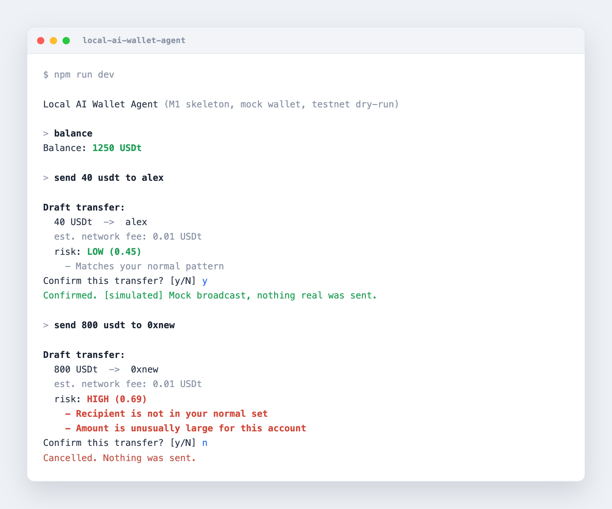

# Local AI Wallet Agent

[](https://github.com/ss1738/local-ai-wallet-agent/actions/workflows/ci.yml)
[](LICENSE)

An on-device AI agent for self-custodial payments. You ask in plain language, it drafts the wallet operation, checks it for risk locally, and does nothing until you confirm. No cloud, no custody of your keys.

Built around Tether's open stack: WDK provides the self-custodial testnet wallet path, and the repository contains an optional QVAC adapter for on-device intent parsing. The default mode is fully runnable with mock adapters, so the complete confirmation-gated flow can be exercised without keys, a network connection, or a model download.

## Demo



It approves a normal payment, then flags a large transfer to a brand-new recipient as HIGH risk and holds it at the confirmation gate.

## Status

The end-to-end flow runs on a mock wallet with rule-based parsing by default. The WDK integration is an opt-in Sepolia testnet path. The QVAC adapter needs validation against a current QVAC SDK release before it should be treated as a supported integration.

- `WALLET_MODE=wdk` connects a **real WDK self-custodial wallet** that derives a real address and reads a live Sepolia testnet balance.
- `AI_MODE=qvac` selects the experimental QVAC adapter. If QVAC is unavailable or the adapter cannot initialize, the agent falls back to the deterministic rule-based parser.

After you confirm, a transfer is broadcast: a real send on the WDK testnet wallet, or a simulated send on the mock wallet. Nothing is ever sent without confirmation. The risk gate is an **on-device anomaly model** (an Isolation Forest fit to the account's transaction profile), with an evaluation harness measuring detection quality. Spending questions are answered from the history using a rule-based summary by default; the QVAC retrieval path is experimental.

## Why

Wallet UX assumes a human clicking through forms, and AI money assistants almost always run in the cloud and take custody of keys. This does the opposite: the intelligence runs on your device (QVAC) and you always hold your keys (WDK). The agent only proposes; you decide.

## Safety model

- No custody. The wallet layer holds the keys; the agent can propose but never independently move funds.
- Human in the loop. Every transfer stops at an explicit confirmation. No silent or automatic sends.
- Bounded action space. The model's output is mapped to a fixed set of vetted operations in deterministic code. A wrong or manipulated model cannot invent an action.
- On-device risk gate. Unusual transfers are flagged before confirmation. Limits are enforced in code, not by the model.
- Testnet first, local by default. No transaction data leaves the device.

## Architecture

```
natural language
      |
  intent parser        rule-based, or on-device QVAC LLM
      |
  policy engine         deterministic: bounded operations, hard limits
      |
   +--+----------------+
   |                   |
 read / draft        risk engine
 via wallet          trained Isolation Forest
 (mock or real WDK)
      |
 confirmation gate     human in the loop
      |
 simulated (mock) or real WDK testnet broadcast
```

The model reaches the wallet through the policy layer only. It proposes an intent; deterministic code decides the operation and enforces the limits.

## Run

Requires Node 20 or newer (QVAC will require Node 22 once wired).

```
npm install
npm run dev
```

Then try:

```
balance
history
address
what did i spend
send 40 usdt to alex
send 800 usdt to 0xnewaddress
```

The last one is flagged as higher risk (new recipient, large amount) and still stops for your confirmation before doing anything.

### Real wallet (Sepolia testnet)

By default the agent uses a mock wallet so it runs offline. To connect a real self-custodial WDK wallet on the Sepolia testnet:

```
WALLET_MODE=wdk npm run dev
```

On first run it generates a testnet seed and saves it to `.wallet/seed.json` (gitignored, testnet only). It prints your address; run `address` to see it again, fund it from a Sepolia faucet, then `balance` reads the live on-chain balance. Keys stay on your device (WDK holds them). After you confirm, a transfer to a valid `0x` address is signed and broadcast to Sepolia (fund the wallet from a faucet first, or the send is rejected for insufficient funds).

### Experimental on-device AI (QVAC)

By default, intent parsing is rule-based so it runs with no model. The repository includes an experimental QVAC adapter, but it requires compatibility validation against the installed QVAC SDK before use:

```
npm install @qvac/sdk
AI_MODE=qvac npm run dev
```

The model only proposes an intent; the deterministic policy layer still validates and bounds every action. If the model is unavailable it falls back to rule-based parsing, so the agent remains functional. Runs best on Apple Silicon.

## Roadmap

- M1 (complete): natural-language intent parsing, deterministic policy, risk gate, human confirmation, and real Sepolia testnet signing and broadcast via WDK.
- M2 (complete): transaction risk gate with an evaluation harness, plus rule-based spending insights over mock history.
- M3: validate and update the QVAC adapter, add a threat model and integration tests, then create a tagged release.

## License

Apache-2.0. See [LICENSE](LICENSE).
